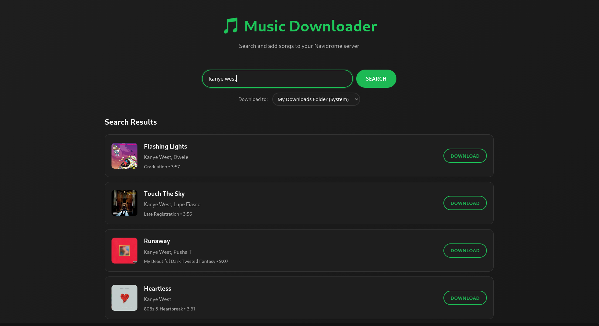
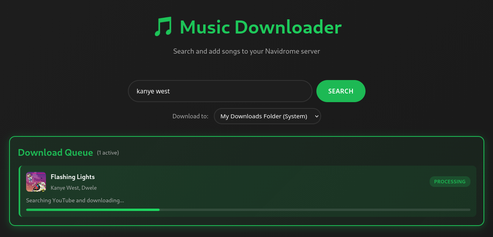

# 🎵 Music Downloader - For Navidrome and local downloads

> Originally based on [soggy8/music-downloader](https://github.com/soggy8/music-downloader) (MIT License). This is an independent, heavily extended version maintained by [Mounstroya](https://github.com/Mounstroya).

> **⚠️ Announcement (March 2025):** Spotify is changing their API requirements. **Apps using Development Mode will stop working after March 9, 2026** unless the app owner has an active Spotify Premium subscription. Migration to a free metadata source (e.g. MusicBrainz) is planned. See [Spotify's migration guide](https://developer.spotify.com/documentation/web-api/tutorials/february-2026-migration-guide) for details.

**Demo: https://mounstroya.github.io/music-downloader/** — try the real interface in your browser with sample data (nothing is downloaded). See [Live demo](#live-demo-github-pages).

A modern web application that allows users to search for songs on Spotify and automatically download them from YouTube, then seamlessly add them to your Navidrome music server. Perfect for building your personal music library with proper metadata, album art, and organized file structure.

## Screenshots

### Main Interface


### Download Queue with Progress Bars


## Features

**New in this version:**

- 📋 **Spotify playlist review** (`/playlist`): import a playlist, see which songs are already in your library, mark them by hand, search YouTube for alternatives, download, listen and approve or reject each download. Bulk "download everything missing" mode.
- 🍪 **YouTube cookies page** (`/cookies`): paste/upload a `cookies.txt`, or download a one-click helper (Windows/Mac/Linux) that extracts the YouTube session from the user's own browser and uploads it. Cookies are tested before saving.
- 🔍 **Smarter YouTube matching**: several query variants are combined (the album name no longer hijacks results when it matches another song's title).
- 🤖 **Resilient against "Sign in to confirm you're not a bot"**: Deno JS runtime + PO tokens (rustypipe-botguard) and automatic retries with back-off across YouTube clients. Better audio quality (audio-only formats instead of 360p video audio).
- 🎤 Synced lyrics (`.lrc`) from lrclib.net.

**Base features:**


- 🎵 Search for songs using Spotify's rich database
- 📥 Automatic download from YouTube using metadata
- 🏷️ Automatic ID3 tagging with artist, album, album art, and metadata
- 📂 Direct upload to Navidrome server or local downloads
- 🎨 Modern, clean web interface with download queue
- ⚡ Real-time download status updates with progress bars
- 📊 Visual download queue showing all active downloads
- 🔄 Choose between local downloads (browser) or Navidrome server upload

## Architecture

- **Frontend**: Vanilla JavaScript, HTML, CSS
- **Backend**: Python FastAPI
- **Spotify API**: For searching and getting track metadata
- **yt-dlp**: For downloading audio from YouTube
- **mutagen**: For ID3 tagging
- **Navidrome**: Music server integration

## Prerequisites

**For Docker (Recommended):**
- Docker and Docker Compose
- Spotify API credentials ([Get them here](https://developer.spotify.com/dashboard))

**For Manual Installation:**
- Python 3.8+ (Python 3.11 recommended, avoid 3.13 due to compatibility issues)
- FFmpeg (required by yt-dlp for audio conversion)
- Spotify API credentials ([Get them here](https://developer.spotify.com/dashboard))
- Navidrome server (optional, for direct server uploads)

## Installation

### Option 1: Docker Compose (Recommended - Easiest!)

**Just 3 steps:**

```bash
# 1. Clone the repo
git clone https://github.com/soggy8/music-downloader.git
cd music-downloader

# 2. Setup environment (add your Spotify credentials)
cp backend/env.example backend/.env
# Edit backend/.env and add your SPOTIFY_CLIENT_ID and SPOTIFY_CLIENT_SECRET

# 3. Run it!
docker-compose up -d
```

Open http://localhost:8000 in your browser. Done! 🎉

> **Note:** If you want to use Navidrome, edit `docker-compose.yml` to mount your Navidrome music directory. See [DOCKER.md](DOCKER.md) for details.

### Option 2: Manual Installation

See [SETUP.md](SETUP.md) for detailed setup instructions.

#### 1. Clone the repository

```bash
git clone <your-repo-url>
cd musicDownloader
```

### 2. Install Python dependencies

```bash
cd backend
pip install -r requirements.txt
```

Or use a virtual environment:

```bash
python -m venv venv
source venv/bin/activate  # On Windows: venv\Scripts\activate
pip install -r requirements.txt
```

### 3. Install FFmpeg

**Ubuntu/Debian:**
```bash
sudo apt update
sudo apt install ffmpeg
```

**macOS:**
```bash
brew install ffmpeg
```

**Windows:**
Download from [FFmpeg website](https://ffmpeg.org/download.html) and add to PATH

### 4. Configure environment variables

Create a `.env` file in the `backend` directory:

```env
# Spotify API Configuration
SPOTIFY_CLIENT_ID=your_spotify_client_id
SPOTIFY_CLIENT_SECRET=your_spotify_client_secret
SPOTIFY_REDIRECT_URI=http://localhost:8000/callback

# Navidrome Configuration
NAVIDROME_MUSIC_PATH=/path/to/navidrome/music
NAVIDROME_API_URL=http://localhost:4533
NAVIDROME_USERNAME=admin
NAVIDROME_PASSWORD=password

# Download Configuration
OUTPUT_FORMAT=mp3
AUDIO_QUALITY=128

# API Configuration
API_HOST=0.0.0.0
API_PORT=8000
CORS_ORIGINS=http://localhost:3000,http://127.0.0.1:3000
```

### 5. Get Spotify API Credentials

1. Go to [Spotify Developer Dashboard](https://developer.spotify.com/dashboard)
2. Create a new app
3. Copy the Client ID and Client Secret
4. Add `http://localhost:8000/callback` to Redirect URIs (optional for client credentials flow)

### 6. Configure Navidrome Path

Set `NAVIDROME_MUSIC_PATH` to the directory where Navidrome stores its music library. This path must be:
- Writable by the user running the backend
- Accessible (local filesystem, NFS mount, or similar)

## Running the Application

### Backend

```bash
cd backend
python app.py
```

Or with uvicorn directly:

```bash
cd backend
uvicorn app:app --host 0.0.0.0 --port 8000 --reload
```

The application (both frontend and API) will be available at `http://localhost:8000`

The frontend is automatically served from the backend, so no separate frontend server is needed.

## Usage

1. Open the web interface in your browser (http://localhost:8000)
2. Choose download location: "My Downloads Folder" or "Navidrome Server"
3. Search for a song, artist, or album
4. Browse the search results
5. Click "Download" on any track you want
6. Watch the progress in the download queue at the top
7. Downloads complete automatically:
   - **Local downloads**: Files are saved to your browser's Downloads folder
   - **Navidrome uploads**: Files are added to your Navidrome library (Artist/Album structure)

## How It Works

1. **Search**: Uses Spotify API to search for tracks and get rich metadata
2. **Download**: Uses yt-dlp to search YouTube and download audio
3. **Tagging**: Applies ID3 tags using metadata from Spotify (title, artist, album, cover art)
4. **Upload**: Copies the file to Navidrome's music directory in organized folders (Artist/Album/)
5. **Scan**: Optionally triggers Navidrome to scan for new files (if API credentials are configured)

## API Endpoints

- `POST /api/search` - Search for tracks on Spotify
  - Body: `{ "query": "search term", "limit": 20 }`
  
- `GET /api/track/{track_id}` - Get details for a specific track

- `POST /api/download` - Start downloading a track
  - Body: `{ "track_id": "spotify_track_id", "location": "local" | "navidrome" }`

- `GET /api/download/status/{track_id}` - Get download status

- `GET /api/health` - Health check endpoint

- `GET /api/library/file?path=<ruta relativa>` - Descarga un archivo de audio de la biblioteca de Navidrome
  (solo rutas dentro de `NAVIDROME_MUSIC_PATH`; es el link que devuelve el MCP)

- `/mcp` - Servidor MCP para agentes de IA (ver abajo)

## MCP para agentes de IA

La app incluye un servidor [MCP](https://modelcontextprotocol.io) (Model Context Protocol) para que
agentes de IA como Claude Code o Claude Desktop puedan buscar, descargar y entregarte canciones.
Está en la misma app, en `http://<host>:8000/mcp`, con transporte **streamable HTTP**. No hay que
levantar nada aparte.

### Conectarlo

**Claude Code**

```bash
claude mcp add --transport http music-downloader http://<host>:8000/mcp
# con MCP_TOKEN definido:
claude mcp add --transport http music-downloader http://<host>:8000/mcp \
  --header "Authorization: Bearer <tu token>"
```

**Claude Desktop**

- *Conector remoto* (Configuración → Conectores → Agregar conector personalizado): pega la URL
  `https://<tu dominio>/mcp`. Los conectores remotos se conectan desde la nube de Anthropic, así que
  la app tiene que ser accesible desde internet (con HTTPS). Si la expones, define `MCP_TOKEN`.
- *Red local* (la app solo es accesible en tu casa): usa el puente `mcp-remote` (requiere Node.js)
  en `claude_desktop_config.json`:

```json
{
  "mcpServers": {
    "music-downloader": {
      "command": "npx",
      "args": ["-y", "mcp-remote", "http://192.168.1.50:8000/mcp", "--allow-http"]
    }
  }
}
```

  Con `MCP_TOKEN`, agrega `"--header", "Authorization:${MD_AUTH}"` a `args` y
  `"env": {"MD_AUTH": "Bearer <tu token>"}`.

Cualquier otro cliente MCP que soporte streamable HTTP sirve igual con la misma URL.

### Herramientas

| Herramienta | Qué hace |
|---|---|
| `buscar_canciones(consulta, limite=5, fuente=None)` | Busca en el catálogo (Spotify/Deezer; `fuente` = `spotify`, `deezer` o `auto`). Devuelve id, nombre, artista, álbum, duración y fuente. |
| `buscar_en_biblioteca(consulta)` | Qué archivos ya existen en la carpeta de música (sin acentos ni mayúsculas), con su ruta y link de descarga. |
| `descargar_cancion(track_id=None, consulta=None, esperar=True, timeout_s=240)` | Descarga una canción a la biblioteca de Navidrome (igual que el botón de la web). Si solo hay `consulta`, toma el mejor resultado del catálogo. Devuelve estado, ruta relativa y link de descarga. |
| `estado_descarga(track_id)` | Estado de una descarga (queued, processing, completed, error). |
| `obtener_cancion(track_id o ruta, incluir_audio=False)` | Link de descarga de una canción de la biblioteca; con `incluir_audio=True` y si pesa ≤ 15 MB, también el audio embebido (base64). |
| `revisar_playlist(url)` | Importa/actualiza una playlist de Spotify o Deezer y la compara con la biblioteca: total, ya están, faltan (lista corta) y por revisar. |
| `descargar_faltantes(playlist_id)` | Descarga masiva de las canciones que faltan de una playlist (una por una, con pausas). |
| `estado_playlist(playlist_id)` | Avance de la playlist y de la descarga masiva. |

La revisión fina de playlists (aprobar, rechazar, elegir otro video) sigue haciéndose en la página `/playlist`.

### Configuración

| Variable | Por defecto | Para qué |
|---|---|---|
| `MCP_TOKEN` | vacío | Vacío = el MCP no pide autenticación (pensado para instalación local). Con valor, se exige `Authorization: Bearer <MCP_TOKEN>`. |
| `PUBLIC_BASE_URL` | vacío | URL base de los links de descarga (p. ej. `https://musica.midominio.com`). Si está vacía se usa la URL con la que llegó la petición, respetando `X-Forwarded-Proto`, `X-Forwarded-Host` y `X-Forwarded-Prefix`. |

> El token protege `/mcp`. El link de descarga (`/api/library/file`) no lo pide, igual que el resto
> de la API de la app, para que se pueda abrir directo en el navegador; no expongas la app a internet
> sin un proxy con autenticación.

## Project Structure

```
music-downloader/
├── backend/
│   ├── app.py                 # FastAPI main application
│   ├── config.py              # Configuration management
│   ├── mcp_server.py          # Servidor MCP para agentes de IA (/mcp)
│   ├── requirements.txt       # Python dependencies
│   ├── env.example            # Environment variables template
│   ├── static                 # Static files
│   │   ├── app.js             # Frontend JavaScript
│   │   └── styles.css         # Styling
│   ├── templates              # Templates
│   │   └── index.html         # Main HTML page
│   ├── services/
│   │   ├── spotify.py         # Spotify API integration
│   │   ├── youtube.py         # YouTube download with yt-dlp
│   │   ├── metadata.py        # ID3 tagging
│   │   └── navidrome.py       # Navidrome integration
│   └── utils/
│       ├── file_handler.py    # File operations
│       └── library_files.py   # Rutas seguras y links de la biblioteca
├── images/                    # Screenshots and images for README
├── Dockerfile                 # Docker image definition
├── docker-compose.yml         # Docker Compose configuration
├── DOCKER.md                  # Docker deployment guide
├── DEPLOYMENT.md              # Server deployment guide
├── SETUP.md                   # Manual setup guide
└── README.md                  # This file
```

## Troubleshooting

### Spotify API Errors

- Make sure your Client ID and Secret are correct
- Check that you've created an app in the Spotify Developer Dashboard

### YouTube Download Fails

- Ensure FFmpeg is installed and in your PATH
- Check your internet connection
- Some videos may be region-locked or unavailable

### YouTube Bot Detection ("Sign in to confirm you're not a bot")

If you see errors like "Sign in to confirm you're not a bot", YouTube is blocking automated requests. You can bypass this by using YouTube cookies:

1. **Export cookies from your browser:**
   - Install a browser extension like "Get cookies.txt LOCALLY" (Chrome/Firefox)
   - Visit youtube.com and log in
   - Export cookies in Netscape format to a file (e.g., `youtube_cookies.txt`)

2. **For Docker:**
   - Mount the cookies file in `docker-compose.yml`:
     ```yaml
     volumes:
       - /path/to/youtube_cookies.txt:/app/youtube_cookies.txt:ro
     ```
   - Set environment variable:
     ```yaml
     environment:
       - YOUTUBE_COOKIES_PATH=/app/youtube_cookies.txt
     ```

3. **For manual installation:**
   - Add to `backend/.env`:
     ```env
     YOUTUBE_COOKIES_PATH=/path/to/youtube_cookies.txt
     ```

**Alternative:** Use yt-dlp to export cookies:
```bash
yt-dlp --cookies-from-browser chrome --cookies youtube_cookies.txt "https://www.youtube.com"
```

**Note:** Cookies expire periodically. Re-export them if downloads start failing again.

### Navidrome Upload Fails

- Verify `NAVIDROME_MUSIC_PATH` is correct and writable
- Check file permissions on the Navidrome music directory
- Ensure the path exists

### CORS Errors

- Update `CORS_ORIGINS` in `.env` to include your frontend URL
- Make sure the frontend is accessing the correct API URL

## Legal Considerations

- This tool is for personal use only
- Respect copyright laws in your jurisdiction
- Spotify API Terms of Service apply
- YouTube Terms of Service apply
- Use responsibly and ethically

## License

This project is licensed under the MIT License - see the [LICENSE](LICENSE) file for details.

## Contributing

Contributions are welcome! Please feel free to submit a Pull Request.

## Description

Music Downloader is a full-stack web application designed to streamline the process of adding music to your Navidrome server. By leveraging Spotify's comprehensive music database for search and metadata, and YouTube as the audio source, it provides a seamless way to discover and download music with proper ID3 tags, album artwork, and organized folder structure.

**Key Benefits:**
- 🚀 **Fast & Efficient**: Single-click downloads with automatic processing
- 📊 **Rich Metadata**: Complete ID3 tags from Spotify (artist, album, year, genre, artwork)
- 🗂️ **Auto-Organization**: Files automatically organized in Artist/Album/ structure
- 🔄 **Auto-Sync**: Automatically triggers Navidrome library scans
- 💻 **Self-Hosted**: Full control over your data and downloads
- 🎨 **Modern UI**: Clean, responsive web interface with visual download queue
- 📥 **Dual Download Options**: Choose between local browser downloads or direct Navidrome server upload
- 📈 **Progress Tracking**: Real-time progress bars and status updates for all downloads
- 🐳 **Docker Ready**: One-command deployment with Docker Compose

Perfect for music enthusiasts who want to expand their Navidrome library quickly and efficiently!

## Live demo (GitHub Pages)

Demo: https://mounstroya.github.io/music-downloader/

The site has a landing page with install instructions and, under `/app/`, the real frontend
(`backend/templates` + `backend/static`) running against a simulated API in the browser
(`demo/mock-api.js`): search, album view, download queue with fake progress, `/playlist` and `/cookies`.
No keys, no real downloads; covers and audio are generated on the fly.

- **Build locally:** `pip install jinja2 && python3 demo/build.py` → output in `demo/dist/`
  (serve it with `python3 -m http.server -d demo/dist`). All paths are relative, so it works under any subpath.
- **Deploy:** `.github/workflows/pages.yml` builds and publishes on every push to `main` (or manually via *Run workflow*).
- **Enable it once:** repository **Settings → Pages → Build and deployment → Source: GitHub Actions**.
- **New endpoints:** if the frontend calls a new `api/...` route, add it to the route table in `demo/mock-api.js`
  (`route('GET', 'thing/:id', ({ params, query, body }) => ({ ... }))`). Unknown routes answer
  `501 {"detail": "...no está disponible en la demo..."}` instead of breaking the page.

## Documentation

- **[DOCKER.md](DOCKER.md)** - Docker deployment guide
- **[DEPLOYMENT.md](DEPLOYMENT.md)** - Production server deployment guide
- **[SETUP.md](SETUP.md)** - Manual installation guide

